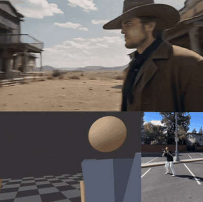

# Film Space Custom

<p>
  
  
  
</p>

**Handheld virtual camera for Windows + Android, with live Blender control.**

<p align="center">
  
  <br>
  <sub>The workflow: block stand-ins in the virtual studio (bottom left), perform the camera move for real with the phone (bottom right), feed the recording to an AI video model for the final look (top).<br>
  Footage from the original <a href="https://github.com/maxprokopp/film-space">film-space</a> iOS demo by maxprokopp; Film Space Custom reproduces the same process on Windows and Android.</sub>
</p>

## Concept

Direct a virtual camera by physically moving your phone. You block a scene with stand-ins, then walk through it holding an Android phone: every step, turn and tilt becomes camera motion, as on a real set. That real, human camera movement drives Blender's camera, live or from a recording, so you can render it with your own characters and environments or use it as a motion reference for AI video tools. It is the [film-space](https://github.com/maxprokopp/film-space) idea (iPhone + ARKit) rebuilt for Windows and Android, with no Mac or iPhone needed.

## What it does

- **Virtual studio** (`index.html`): 20 × 20 m checkerboard floor, 1 m grid, axes and 1.75 m human stand-ins. In **Edit** mode you orbit, zoom and pan the view, add, move, rotate and delete stand-ins, raise or lower the framing, and lock or return to a viewpoint. The layout is saved in the page URL.
- **Camera mode**: on an Android phone (Chrome + ARCore), WebXR tracks the phone in 6DoF, the same kind of tracking as ARKit, and the virtual camera follows it. Real steps become real distances, and turning or tilting the phone aims the camera. On a PC the same mode uses WASD + mouse. Lenses: 35, 50, 75 and 200 mm (full frame). **Shoulder** places the camera at 1.5 m in the scene centre.
- **Recording**: REC saves the rendered view as `.mp4` plus a `.json` file with the camera track (time, position, rotation, lens) and the stand-in layout.
- **Blender import** (`film_space_import.py`): turns the `.json` into an animated camera (location, rotation and focal length on a 36 mm sensor, at the scene's FPS) plus stand-in figures.
- **Blender live** (`film_space_live.py`): Blender serves the page to the phone and receives its pose about 60 times a second. It applies the pose to the active camera with smoothing, and records keyframes while the timeline plays with Auto Keying on.

## Setup and use with Blender

Requirements: Windows PC with Blender (tested on 4.5), an Android phone with Chrome and ARCore, and a USB cable with [adb](https://developer.android.com/tools/releases/platform-tools) (USB debugging enabled on the phone).

### Live: the phone is Blender's camera

1. Clone this repo. In Blender go to **Scripting**, open `film_space_live.py` and press **Run Script**. Blender now serves the page on port 8001.
2. Connect the phone over USB and run:
   ```bash
   adb reverse tcp:8001 tcp:8001
   ```
3. On the phone, open `http://localhost:8001/?blender` in Chrome.
4. In Blender, look through the camera (Numpad 0). On the phone, press **Camera**: Blender's active camera starts from its current position and follows your steps and phone movements. The lens button also sets Blender's focal length.
5. To reposition, move the camera in Blender, then on the phone press **Edit** and **Camera** again: the motion re-anchors to the camera's new pose.
6. To record a take, enable **Auto Keying** (●) and press **Play**: the motion is written as keyframes.

Tuning at the top of `film_space_live.py`:
- `SCALE`: Blender units per real metre walked. Use 10 to cross a large set with a few steps.
- `SMOOTH`: 0 gives raw tracking; values closer to 1 are smoother but lag more.

### From a recording

1. Serve the page on the PC with `python -m http.server 8000` in the repo folder.
2. Run `adb reverse tcp:8000 tcp:8000`, then open `http://localhost:8000` on the phone.
3. Block the scene, press **Camera** and record with **● REC**. You get `film-space-<date>.mp4` and `film-space-<date>.json`.
4. In Blender go to **Scripting**, open `film_space_import.py`, set `PATH` to the `.json` and press **Run Script**. You get a `FilmSpace` collection with an animated `FilmSpaceCam` and `StandIn.NN` figures to replace with your characters. From a terminal you can instead run:
   ```bash
   blender --python film_space_import.py -- C:\path\film-space-XXXX.json
   ```

Notes:
- The phone shows the stand-in scene, not Blender's viewport, so watch the PC monitor while you shoot.
- The scripts set the camera to quaternion rotation and a 36 mm horizontal sensor.
- Port 8001 is open on your local network while the live script runs.
